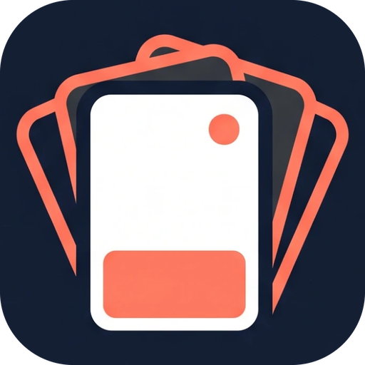
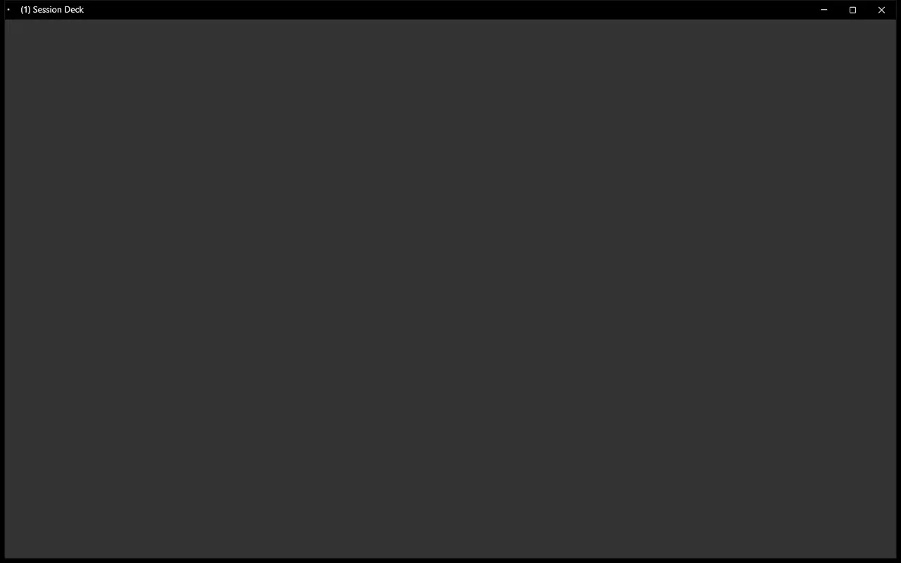
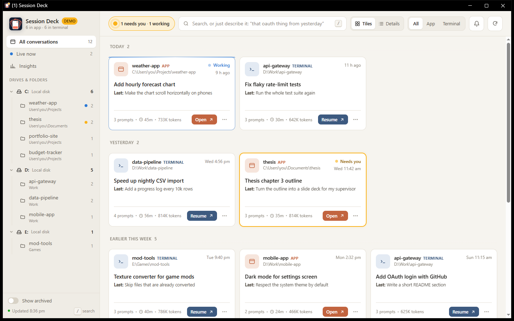
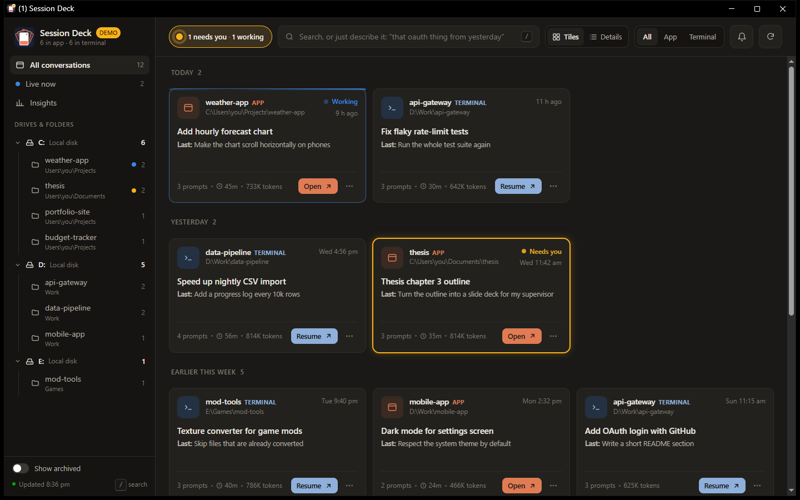
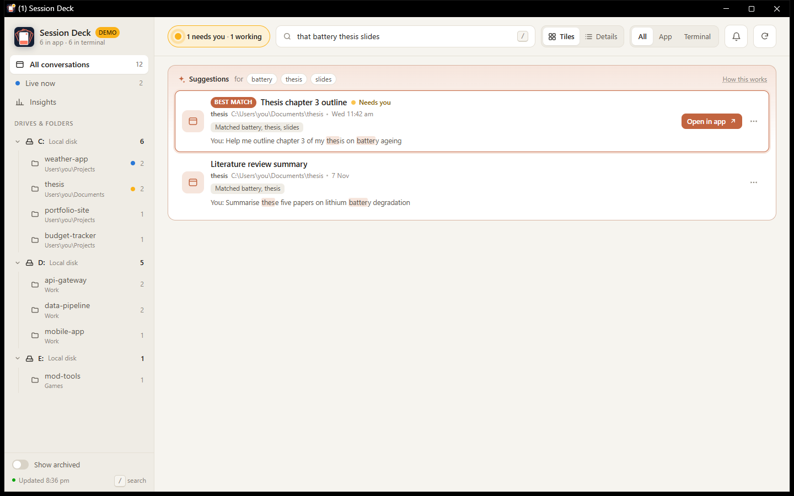
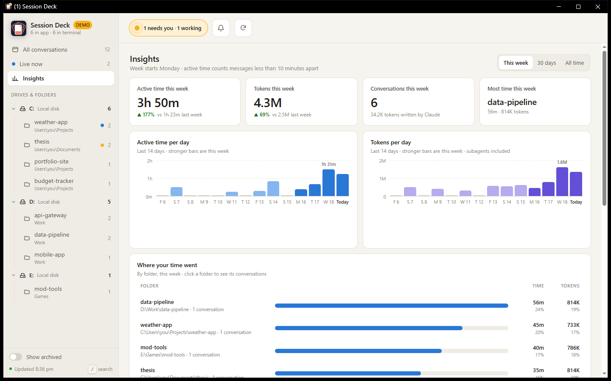

<p align="center">
  
</p>

<h1 align="center">Session Deck</h1>

<p align="center">
  <b>Every Claude Code conversation on your PC, one click away.</b><br>
  An unofficial companion app for Claude Code on Windows — free, open source, works offline.
</p>

<p align="center">
  <a href="https://github.com/optimus-ook-prime-gluk/session-deck/releases/latest"><b>⬇ Download for Windows</b></a> ·
  <a href="#features">Features</a> ·
  <a href="#privacy">Privacy</a> ·
  <a href="#faq">FAQ</a>
</p>

<p align="center">
  
  <br><sub>Demo recorded with made-up sample sessions (<code>--demo</code>).</sub>
</p>

---

If you use **Claude Code** in both the **Claude desktop app** and the **terminal**, your conversations end up scattered
across folders and tools. Session Deck lists all of them in one window — and when you click one, it reopens it
**right where it lives**:

- a desktop-app conversation opens **in the Claude app**, on that exact conversation;
- a terminal conversation resumes in a **new `cmd` window, in its folder** (`claude --resume …`).

## Install

1. Download **`SessionDeck-Setup-x.y.z.exe`** from the [latest release](https://github.com/optimus-ook-prime-gluk/session-deck/releases/latest) and run it.
   It installs just for you — **no admin rights**.
2. Windows SmartScreen may say *"Windows protected your PC"* because the app isn't code-signed yet → **More info → Run anyway**.
3. Open **Session Deck** from the Start Menu or desktop.

**There is no account or login.** Session Deck reads the Claude Code data that's already on your PC, so whatever you're
signed into in Claude Code is what you'll see.

No installer wanted? Grab the **portable zip**, extract it anywhere and run `SessionDeck.exe`.

**Requirements**
- Windows 10 or 11 (Microsoft Edge, built into Windows, draws the window)
- Claude Code — the `claude` CLI and/or the Claude desktop app's Code tab

Just curious? Start Menu → **Session Deck (demo with sample sessions)** runs it with made-up data.

## Features

| | |
|---|---|
| **All sessions in one place** | Desktop-app and terminal conversations together, newest first, grouped by day. **Tiles** or **details** view. |
| **Reopen where it lives** | App chats jump straight to that conversation in the Claude app; terminal chats resume in `cmd` in the right folder. Right-click for *open folder*, *copy resume command*, … |
| **Drives & folders** | The sidebar groups every project folder by drive (C:, D:, E: …), with live dots when something there is running. |
| **Search, or just describe it** | Type words to filter instantly — or write what you remember: *"that battery thesis slides from wednesday"*, *"the game thing on f drive"*, *"textur convertr"* (typos are fine). Understands time words, *terminal / app*, drives and *running*. Runs fully offline. |
| **Live beacon** | Shows which sessions are **working**, **need you** (e.g. waiting for a permission) or have **finished**. |
| **Alerts** | When a session finishes or needs you: the window glows, a chime plays, Windows shows a notification and the taskbar button flashes — each can be turned off. |
| **Insights** | Active time and tokens per day, this week vs last, where your time went by folder, app vs terminal, token breakdown. |
| **Comfortable** | Auto-refresh, keyboard navigation (`/` search, arrows, `Enter` open, `Shift+Enter` open in terminal), light / dark / system theme. |

<table>
  <tr>
    <td></td>
    <td></td>
  </tr>
  <tr>
    <td></td>
    <td></td>
  </tr>
</table>

## Privacy

- **Everything stays on your PC.** No internet access, no telemetry, no AI or cloud services — search suggestions are
  computed locally with the Python standard library.
- The window talks to a tiny server bound to `127.0.0.1` only; every request needs a random key created at start-up.
- Session Deck only **reads** Claude Code's files — it never changes them:
  - `%USERPROFILE%\.claude\projects` — conversation transcripts
  - `%USERPROFILE%\.claude\sessions` — which sessions are running right now
  - the Claude desktop app's session list under `%LOCALAPPDATA%\Claude-Data` (or `%APPDATA%\Claude`)
- Its own files (cache, a local search index of your conversations, settings) live in `%LOCALAPPDATA%\SessionDeck`
  and are removed by the uninstaller.

## How it works

- **Python 3 standard library** web server + a single HTML page shown in an Edge app window (`--app`), packaged with
  PyInstaller and installed with Inno Setup.
- Transcripts are parsed **incrementally** (only new bytes are read), so it stays fast while sessions grow.
- Desktop-app conversations are matched to their transcripts through the app's local session list, and opened with
  the app's `claude://` link.
- Live status comes from the small status files Claude Code writes for each running session (`busy` / `idle` /
  `waiting`); transitions trigger the alerts.
- *Search*: Okapi BM25 ranking over titles, folders, your prompts and Claude's replies, plus related-word expansion,
  typo matching and time/terminal/drive hints — see [`src/suggest.py`](src/suggest.py).

> **Heads-up:** Session Deck relies on how Claude Code stores data locally. Those formats aren't a public API, so a
> Claude Code update could break part of it (most likely opening desktop-app chats or live alerts). Please
> [open an issue](https://github.com/optimus-ook-prime-gluk/session-deck/issues) if something stops working.

## FAQ

**Do I need to log in?** No. There's no account. It shows whatever Claude Code has stored on this PC.

**It says "No Claude Code sessions found yet".** Start a conversation in Claude Code (CLI or desktop app), then come
back — the list refreshes by itself.

**Clicking a terminal session does nothing / shows an error.** The `claude` command must be installed and on your
PATH, and the session's folder must still exist.

**Windows notifications don't appear.** Click the bell (🔔) → *Allow notifications*, then try *Test "finished"*.

**Mac or Linux?** Not yet — the window, taskbar and terminal integration are Windows-specific. Contributions welcome.

**How do I uninstall?** Settings → Apps → *Session Deck* → Uninstall. Your Claude Code data is untouched.

## Run from source

```powershell
git clone https://github.com/optimus-ook-prime-gluk/session-deck
cd session-deck
python src\session_deck.py          # or:  python src\session_deck.py --demo
python -m unittest discover -s tests -v
```

Build the installer yourself with `.\build.ps1` (needs `pip install -r requirements-dev.txt` and Inno Setup 6), or
push a `v*` tag and GitHub Actions builds and publishes the release.

## Credits

- **Okapi BM25** ranking — S. E. Robertson, S. Walker, S. Jones, M. Hancock-Beaulieu and M. Gatford, *Okapi at TREC-3*
  (1994), building on the probabilistic relevance framework of S. E. Robertson and K. Spärck Jones. Implemented from
  the published formula.
- **Typo matching** — Python's standard-library `difflib` (Ratcliff/Obershelp "gestalt pattern matching").
- **Logo** — artwork generated with Google Gemini; the small taskbar version is a hand-drawn simplification.
- **Chart colours** follow a colour-blind-validated categorical palette.
- **Ideas** — searching and resuming Claude Code sessions is also explored by community projects such as
  [claude-smart-fork](https://pypi.org/project/claude-smart-fork/),
  [claude-code-search](https://pypi.org/project/claude-code-search/),
  [sessfind](https://letsdev-it.github.io/sessfind/architecture/how-it-works/),
  [session-search](https://github.com/tjp2021/session-search),
  [session-seek](https://gh.r-mj.com/AndySze/session-seek),
  [Claudia / opcode](https://github.com/getAsterisk/opcode),
  [ccsessions](https://github.com/miskiewiczm/ccsessions) and [sessy](https://docs.rs/crate/sessy).
  No code from these projects is used.
- Built with [PyInstaller](https://pyinstaller.org) and [Inno Setup](https://jrsoftware.org/isinfo.php).

## License

[MIT](LICENSE) © 2026 optimus-ook-prime-gluk

*Session Deck is an independent project. It is not made by, affiliated with or endorsed by Anthropic.
"Claude" and "Claude Code" are trademarks of Anthropic.*
